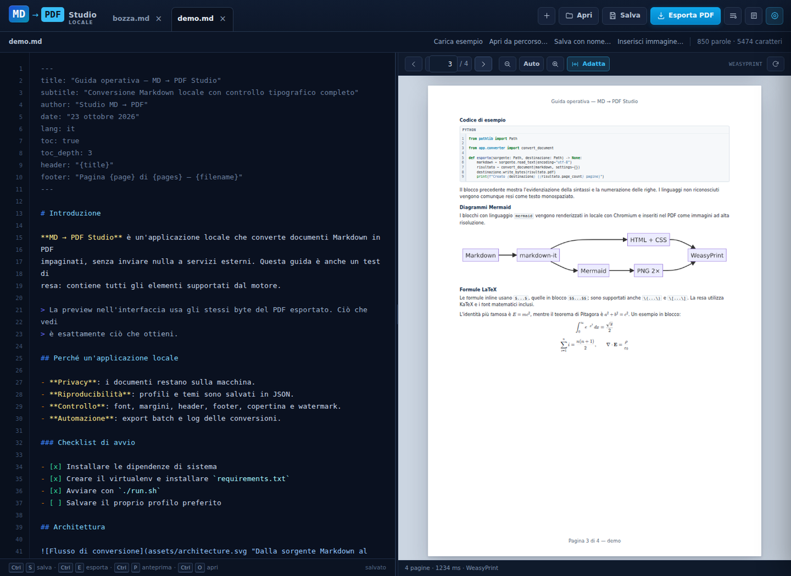
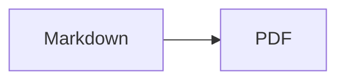

# MD → PDF Studio

**Scrivi Markdown. Esporta un PDF che sembra impaginato da qualcuno.**


Applicazione web **locale** per convertire Markdown in PDF, con editor, anteprima PDF
fedele in tempo reale, controllo tipografico completo, profili di stile riutilizzabili
ed esportazione batch.



## In breve

- **Nessun documento lascia la macchina**: backend e frontend girano su `127.0.0.1`.
- **Preview = PDF finale**: l'anteprima usa gli stessi byte del PDF esportato, renderizzati
  con PDF.js (pagina per pagina).
- **Diagrammi e formule**: Mermaid e LaTeX (KaTeX) renderizzati in locale.
- **Marp slides**: modalità presentazione 16:9/4:3, una slide per pagina PDF.
- **Tipografia completa**: font, margini, header/footer, copertina, watermark, TOC,
  numerazione di titoli, tabelle e figure.
- **Export singolo o batch**, con log delle conversioni e bozza automatica.
- **Un solo comando**: `./run.sh` (oppure `make run`).

## Avvio rapido

Requisiti: Python 3.10+, le librerie di sistema di WeasyPrint (Pango/Cairo) e,
per il fallback Chromium, un browser Chrome/Chromium.

```bash
git clone https://github.com/riccardoFus/mdtopdf-ui.git
cd mdtopdf-ui
./install.sh
./run.sh
# → http://127.0.0.1:8765
```

Se la virtualenv esiste già, `./run.sh` parte direttamente. Le istruzioni complete
per Debian/Ubuntu, macOS e Windows sono nella sezione **Installazione**.

---

## 1. Da dove nasce

### Il file di partenza

Lo script originale `md_to_pdf.py` (261 righe) **non è stato modificato né eliminato**.
Una copia di riferimento è in [`legacy/md_to_pdf.py`](legacy/md_to_pdf.py), insieme a
[`legacy/README.md`](legacy/README.md).

Un secondo script, un utility OCR PDF → Markdown, non è stato toccato: non era il
convertitore `md to pdf`.

### Funzionalità estratte dal legacy

| Area | Comportamento dello script |
|---|---|
| Interfaccia | CLI: `python md_to_pdf.py input.md [output.pdf]` |
| Motore | `pandoc --pdf-engine=weasyprint` |
| Markdown | `markdown+gfm_auto_identifiers` |
| Risorse | `--resource-path` = cartella del file sorgente |
| Metadati | titolo PDF = nome file (`--metadata title=...`) |
| Pagina | A4, margini 1.5 / 1.5 / 2 / 1.5 cm |
| Footer | `counter(page) " / " counter(pages)`, 9pt, grigio |
| Font | DejaVu Sans 10pt, line-height 1.4, colore `#333` |
| Titoli | H1–H6 con colori blu, bordi su H1/H2, `page-break-after: avoid` |
| Codice | sfondo chiaro, bordo, `white-space: pre-wrap` per evitare tagli |
| Checklist | checkbox nativi nascosti e sostituiti con quadratini CSS |
| Tabelle | bordi, header colorato, righe alternate |
| Citazioni | bordo sinistro blu e sfondo azzurro |
| Immagini | `max-width: 100%` |
| Interruzioni | `page-break-inside: avoid` su `pre` e `blockquote` |

### Cosa è stato migrato

- Stile di base: A4, margini generosi, footer con `{page} / {pages}`, DejaVu, titoli blu.
- Tabelle con header e righe alternate, blockquote, codice con wrapping, checklist CSS.
- Risoluzione delle immagini relative alla cartella del documento.
- Evita titoli orfani e interruzioni dentro blocchi di codice/immagini.

### Cosa è stato migliorato

- GUI completa con editor, tab multipli, drag & drop, anteprima paginata e zoom.
- Markdown-it-py al posto di Pandoc: tabelle, checklist, footnotes, attributi, linkify,
  frontmatter YAML, TOC con link interni, numerazione titoli/tabelle/figure.
- WeasyPrint come motore principale con fallback Chromium/Playwright.
- Diagrammi **Mermaid** renderizzati in locale e formule **LaTeX** con KaTeX.
- Deck **Marp** con slide 16:9/4:3, paginazione, classi e direttive principali.
- Profili, temi, colori, copertina, watermark, header/footer con variabili.
- Formati pagina, orientamento, margini separati, scala, larghezza immagini.
- Export singolo e batch, log delle conversioni, bozza automatica.
- Errori non bloccanti e messaggi chiari (nessun `alert()`).
- Test automatici di parsing, CSS, API, resa PDF e UI.

### Cosa resta da implementare / limitazioni note

- **Note**: le footnote Markdown vengono raccolte in una sezione di chiusura (endnotes),
  non apposte in fondo alla singola pagina. È il comportamento del legacy e di Pandoc;
  una futura iterazione può usare le footnote CSS di WeasyPrint.
- **Fallback Chromium**: supporta la resa di base, ma header/footer CSS e alcune proprietà
  paged-media possono differire da WeasyPrint (l'app lo segnala nei warning).
- **Dialogo di salvataggio**: l'export singolo usa il dialogo nativo `zenity`/`kdialog`
  lanciato dal server locale, quindi funziona anche in Firefox. Se manca un helper o un
  ambiente grafico, si usa il picker del browser (Chrome/Edge) o un download; in quel caso
  il percorso è deciso dal browser. La copia automatica in `output/` garantisce comunque
  un archivio con percorso noto e loggato.
- **Mermaid e LaTeX** richiedono Chromium/Playwright, perché il rendering avviene in un
  browser headless locale. Senza browser il documento resta convertibile, ma diagrammi e
  formule vengono mostrati come codice con un warning esplicito.
- Mermaid viene rasterizzato in PNG ad alta risoluzione (2×): ottimo per il PDF, ma non
  è testo vettoriale selezionabile. KaTeX supporta LaTeX matematico comune, non pacchetti
  TeX arbitrari (TikZ, `\usepackage`, `\ref`, ecc.).
- **Immagini relative** con file caricati dal browser: il browser non espone la cartella
  sorgente. Usa “Apri da percorso…” oppure percorsi assoluti/URL/immagini caricate.
- **Batch**: i file caricati non hanno una cartella base, quindi le immagini relative
  vanno referenziate con percorso assoluto o URL.
- I numeri di riga dell'editor sono per riga logica: righe molto lunghe che vanno a capo
  possono disallineare visivamente la numerazione (il PDF non è influenzato).
- I font devono essere installati nel sistema (fontconfig). In assenza del font scelto
  si usa il fallback generico.
- Il tema `dark` produce pagine con sfondo scuro: è voluto, ma è ink-heavy in stampa.
- **Marp** è supportato in modalità compatibile integrata, non tramite Marp CLI: temi
  `default`/`gaia`/`uncover` sono approssimati, i CSS/temi Marp esterni non sono caricati
  e le slide troppo piene vengono ritagliate anziché auto-scalate.

---

## 2. Installazione

### Requisiti di sistema

- Linux con Python **3.11+** (testato con 3.13).
- Un browser moderno (Chrome/Chromium/Firefox).
- Librerie Pango/Cairo per WeasyPrint.
- **Google Chrome/Chromium**: necessario per Mermaid, LaTeX, fallback di conversione e test UI.
- Per il dialogo di salvataggio nativo su Linux: **zenity** (GNOME) oppure **kdialog** (KDE).
  Sono opzionali: senza di essi si usa il dialogo del browser o il download.

#### Debian / Ubuntu

```bash
sudo apt update
sudo apt install -y python3 python3-venv python3-pip \
  libpango-1.0-0 libpangoft2-1.0-0 libharfbuzz0b libcairo2 libgdk-pixbuf-2.0-0 \
  fonts-dejavu-core fonts-noto-color-emoji

# Necessario per Mermaid/LaTeX, fallback e test UI
sudo apt install -y chromium || sudo apt install -y google-chrome-stable

# Dialogo di salvataggio nativo (consigliato; alternativa: kdialog)
sudo apt install -y zenity
```

> Se `python3 -m venv` fallisce con “ensurepip is not available”, manca `python3-venv`:
> `sudo apt install python3-venv` (oppure `python3.12-venv` per la versione specifica).

#### Arch Linux

```bash
sudo pacman -S --needed python python-pip pango cairo gdk-pixbuf2 harfbuzz \
  ttf-dejavu noto-fonts-emoji

# Necessario per Mermaid/LaTeX, fallback e test UI
sudo pacman -S --needed chromium

# Dialogo di salvataggio nativo (una delle due alternative)
sudo pacman -S --needed zenity
```

#### Fedora

```bash
sudo dnf install -y python3 python3-pip pango cairo gdk-pixbuf2 harfbuzz \
  dejavu-sans-fonts google-noto-color-emoji-fonts
```

### Installazione dell'app

```bash
cd ~/Scrivania/Web\ Apps/MdToPdf-UI
./install.sh
```

`install.sh` crea `.venv`, installa `requirements.txt` e verifica WeasyPrint.
Se il virtualenv esiste già, lo riusa.

Installazione manuale equivalente:

```bash
python3 -m venv .venv
.venv/bin/pip install -r requirements.txt
```

### Avvio

```bash
./run.sh
# oppure
make run
```

Apre automaticamente `http://127.0.0.1:8765` (se c'è un ambiente grafico).
Per non aprire il browser: `MD2PDF_NO_BROWSER=1 ./run.sh`.
Per cambiare porta: `PORT=9000 ./run.sh`.

Altri comandi:

```bash
make test     # pytest -q
make sample   # genera output/esempio-completo.pdf
```

---

## 3. Architettura

```
MdToPdf-UI/
├── app/
│   ├── main.py             # FastAPI, REST API, static files
│   ├── config.py           # default, validazione, profili, temi, store JSON
│   ├── markdown_engine.py  # frontmatter, markdown-it, TOC, Pygments, immagini
│   ├── styling.py          # CSS paged-media generato dalle impostazioni
│   ├── converter.py        # pipeline Markdown → HTML → PDF
│   ├── pdf_engine.py       # WeasyPrint + fallback Chromium/Playwright
│   ├── rich_rendering.py   # Mermaid → PNG, LaTeX → KaTeX HTML (caching)
│   ├── desktop_dialog.py   # dialogo nativo zenity/kdialog
│   └── __init__.py
├── static/
│   ├── index.html          # SPA (editor + preview + impostazioni)
│   ├── css/app.css
│   ├── js/app.js           # stato, editor, PDF.js, profili, export
│   ├── img/favicon.svg
│   └── vendor/
│       ├── pdfjs/          # PDF.js 4.10.38 (Apache-2.0)
│       ├── katex/          # KaTeX 0.16.11 + font matematici (MIT)
│       └── mermaid/        # Mermaid 10.9.1 (MIT)
├── examples/
│   ├── demo.md             # documento dimostrativo completo
│   ├── marp-demo.md        # presentazione Marp di esempio
│   └── assets/architecture.svg
├── tests/                  # 129 test pytest (unit, API, resa PDF, UI)
├── legacy/                 # copia read-only dello script originale
├── scripts/make_sample.py  # genera il PDF di esempio
├── scripts/make_marp_sample.py # genera output/marp-demo.pdf
├── config.json             # profili/temi/preferenze (creato/aggiornato a runtime)
├── requirements.txt
├── install.sh / run.sh / Makefile
├── README.md
└── output/                 # PDF esportati (default)
```

### Pipeline

1. L'editor invia Markdown + impostazioni a `POST /api/preview` (debounce 380 ms).
2. Il backend estrae il frontmatter YAML, valida le impostazioni, converte Markdown in HTML
   con markdown-it-py (tabelle, checklist, footnote, attributi, linkify), evidenzia il codice
   con Pygments e genera il TOC con anchor stabili.
3. `styling.py` produce il CSS `@page` (formato, margini, header/footer, copertina,
   watermark, temi, tipografia, interruzioni di pagina).
4. WeasyPrint (o Chromium) genera il PDF.
5. La preview riceve **il PDF reale** in base64 e lo renderizza con PDF.js: zoom, fit-width,
   paginazione e indicatore pagina/totale.
6. L'export singolo apre il **dialogo di salvataggio nativo del sistema** (zenity/kdialog)
   e scrive lì il PDF, lasciando anche una **copia automatica** in `output/`; l'export
   batch usa la cartella configurata. Entrambi registrano l'esito nei log.

La preview è fedele per costruzione: non è un secondo rendering HTML, ma il PDF esportato.

---

## 4. Funzionalità implementate

### Editor e documenti

- Editor Markdown con highlighting leggero e numeri di riga.
- Tab multipli, drag & drop di `.md`, `.markdown`, `.mdown`, `.txt`.
- Apertura da file picker o da percorso assoluto (per immagini relative).
- Salvataggio `.md` (Ctrl+S / “Salva con nome”).
- Bozza automatica in `~/.config/md-to-pdf-studio/draft.md`.
- Ripristino tab e bozza al riavvio.

### Markdown

- H1–H6, grassetto, corsivo, barrato, codice inline.
- Liste puntate/numerate/annidate e checklist (`- [x]`).
- Tabelle GFM con allineamento colonne.
- Blockquote, link, immagini locali/remote.
- Didascalie figure (alt/title) e numerazione figure.
- Blocchi codice con Pygments e numeri di riga opzionali (`linenums` o impostazione).
- Diagrammi **Mermaid** (`flowchart`, `sequence`, `class`, `state`, `gantt`, `pie`, `er`, ecc.).
- Formule **LaTeX** inline (`$...$`, `\(...\)`) e in blocco (`$$...$$`, `\[...\]`) con KaTeX.
- Presentazioni **Marp** con slide 16:9/4:3, paginazione, direttive `_class`/`_paginate`
  e Mermaid/LaTeX dentro ogni slide.
- Frontmatter YAML: `title`, `subtitle`, `author`, `date`, `lang`, `toc`, `toc_depth`,
  `header`, `footer`.
- TOC automatico con profondità 1–6, numeri di pagina e link interni PDF funzionanti.
- Interruzioni di pagina: `<!-- pagebreak -->`, `\newpage`, `\pagebreak`.
- Caratteri speciali, emoji, accenti italiani.

### Formattazione

- Font separati per corpo, titoli e codice; elenco font di sistema.
- Corpo 8–24 pt; dimensioni H1–H4, tabelle, codice e didascalie.
- Interlinea, spazio paragrafi, rientro liste, allineamento sinistra/giustificato/centro.
- Temi: `light`, `dark`, `print`, `minimal`, `academic`, `technical`.
- Colori personalizzabili e tema custom salvabile con nome.
- Numerazione titoli, tabelle, figure e pagine, attivabile singolarmente.
- Header/footer con `{title}`, `{author}`, `{date}`, `{page}`, `{pages}`, `{filename}`.
- Copertina con titolo, sottotitolo, autore, data e logo/immagine.
- Watermark con testo, opacità, rotazione, colore e posizione.

### Pagina e PDF

- Formati A4, A3, A5, Letter, Legal, custom in mm.
- Orientamento verticale/orizzontale.
- Margini separati top/bottom/left/right.
- Scala contenuto, larghezza massima immagini.
- Evita titoli orfani e interruzioni dentro tabelle/codice/figure.
- Nome file PDF configurabile e **dialogo nativo di sistema** per scegliere dove salvare
  il singolo PDF (funziona anche con Firefox).
- Copia automatica del singolo export in `output/` (o nella cartella configurata).
- Export batch nella cartella configurabile e profilo di stile in JSON.
- Log con timestamp, esito, durata, pagine, motore, percorso e numero di warning.
- Errori non bloccanti con toast; nessun `alert()`.

### Profili predefiniti

- **Documento semplice** — A4, tipografia lineare.
- **Report tecnico** — TOC, numerazione, header/footer, tema technical.
- **Articolo** — serif, giustificato, margini ampi, tema academic.
- **Slide/handout** — A4 landscape, font grandi, immagini contenute.
- **Codice** — numeri di riga, font compatto, focus su blocchi codice.

I profili sono applicabili, salvabili, duplicabili, rinominabili, eliminabili,
esportabili/importabili in JSON.

---

## 5. Sintassi e impostazioni utili

### Frontmatter

```yaml
---
title: "Relazione tecnica"
subtitle: "Versione 1.0"
author: "Mario Rossi"
date: "23 ottobre 2026"
lang: it
toc: true
toc_depth: 3
header: "{title}"
footer: "Pagina {page} di {pages} — {filename}"
---
```

Un `header`/`footer` stringa sostituisce tutti gli slot; usa la forma a mappa per
controllare singolarmente `left`, `center`, `right`:

```yaml
header:
  left: "{title}"
  right: "{date}"
footer:
  center: "{page} / {pages}"
```

### Immagini

```markdown

```

- Percorsi relativi: risolti rispetto alla cartella del documento **solo** aprendo il file
  da percorso o usando l'API con `base_dir`.
- Per i file caricati dal browser usa un percorso assoluto, un URL o “Inserisci immagine…”
  (l'immagine viene copiata in `~/.config/md-to-pdf-studio/assets/`).
- Le immagini mancanti non bloccano la conversione: producono un placeholder e un warning.

### Codice con numeri di riga

~~~markdown
```python linenums
print("ciao")
```
~~~

In alternativa attiva “Numeri di riga nei blocchi codice” nelle impostazioni.

### Pagine

```markdown
<!-- pagebreak -->

\newpage
```

### Mermaid

I blocchi con linguaggio `mermaid` vengono trasformati in diagrammi locali:

~~~markdown

~~~

Il rendering usa Chromium headless (Playwright) e produce un PNG trasparente ad alta
risoluzione, inserito nel PDF. I risultati sono memorizzati in cache per contenuto/tema, quindi
modificare il testo attorno a un diagramma non lo rigenera.

Sono supportati i diagrammi offerti da Mermaid 10.9.1 (flowchart, sequence, class, state,
ER, gantt, pie, journey, gitGraph, timeline, mindmap…). In caso di sintassi non valida il
documento continua a convertirsi mostrando il codice e un warning.

### LaTeX

```markdown
Formula inline: $E = mc^2$ e \(a^2+b^2=c^2\).

$$
\int_0^\infty e^{-x^2}\,dx = \frac{\sqrt{\pi}}{2}
$$
```

KaTeX renderizza le formule in HTML/CSS con font matematici inclusi; l'allineamento
inline è nativo e le formule in blocco non vengono spezzate tra le pagine. Sono supportati
anche i delimitatori `\(...\)` e `\[...\]`. Errori di sintassi producono un fallback
leggibile e un warning, senza interrompere l'esportazione.

> Mermaid e LaTeX richiedono Chromium/Playwright. L'app mostra lo stato nel pannello
> **PDF → Ambiente locale** e nei warning di conversione.

### Marp slides

Un documento con `marp: true` nel frontmatter viene trattato come presentazione:

```markdown
---
marp: true
size: 16:9
theme: default
paginate: true
---

<!-- _class: lead -->
<!-- _paginate: false -->

# Titolo

---

## Seconda slide

Contenuto.
```

- Le slide sono separate da `---` fuori dai blocchi di codice.
- `size`: `16:9` (default), `4:3`, `16:10`; una slide = una pagina PDF.
- `theme`: `default`, `gaia`, `uncover` (stili integrati semplificati).
- `paginate: true/false` e `<!-- _paginate: false -->` per la singola slide.
- `<!-- _class: lead -->` centra la slide; le altre classi vengono conservate.
- `_backgroundColor` e `_color` applicano colori inline alla slide.
- Mermaid, KaTeX, immagini, tabelle, checklist e codice funzionano dentro le slide.
- Copertina, TOC, watermark e header/footer del documento normale vengono disattivati
  automaticamente in modalità Marp.

**Limiti della modalità Marp integrata:** non usa Marp CLI, non carica temi/CSS Marp
esterni, non supporta transizioni, note presenter, `_header`/`_footer` o l'auto-scaling
delle slide troppo piene (il contenuto in eccesso viene ritagliato). Per deck molto
complessi conviene dividere il contenuto in più slide.

---

## 6. Scorciatoie

| Scorciatoia | Azione |
|---|---|
| `Ctrl+S` | Salva il Markdown |
| `Ctrl+E` | Esporta il PDF |
| `Ctrl+P` | Aggiorna subito l'anteprima |
| `Ctrl+O` | Apri un file |
| `Ctrl+N` | Nuovo documento |
| `Ctrl+,` | Apri/chiudi impostazioni |
| `Ctrl++` / `Ctrl+-` | Zoom anteprima |
| `Ctrl+rotella` | Zoom anteprima |

---

## 7. API REST

| Metodo | Percorso | Descrizione |
|---|---|---|
| GET | `/api/health` | Stato e motori disponibili |
| GET | `/api/config` | Impostazioni, profili, temi, font, percorsi |
| POST | `/api/preview` | PDF base64 + pagina/heading/warning |
| POST | `/api/convert` | Genera e salva il PDF nella cartella server |
| POST | `/api/export` | Genera il PDF per il picker del browser + copia automatica in `output/` |
| POST | `/api/export-dialog` | Apre il dialogo di sistema (zenity/kdialog) e scrive il PDF scelto |
| POST | `/api/batch` | Converte più documenti |
| GET/POST | `/api/profiles` | Elenco/salvataggio profili |
| POST | `/api/profiles/{name}/rename` | Rinomina |
| POST | `/api/profiles/{name}/duplicate` | Duplica |
| DELETE | `/api/profiles/{name}` | Elimina |
| GET | `/api/profiles/{name}/export` | Esporta JSON |
| POST | `/api/profiles/import` | Importa JSON |
| POST/DELETE | `/api/themes` | Temi personalizzati |
| GET/POST | `/api/draft` | Bozza automatica |
| POST | `/api/open` | Apre un file locale |
| POST | `/api/save` | Salva Markdown |
| POST | `/api/assets` | Carica immagine |
| GET | `/api/logs` | Log conversioni |
| DELETE | `/api/logs` | Svuota log |
| GET | `/api/example` | Documento dimostrativo |

Esempio:

```bash
curl -s -X POST http://127.0.0.1:8765/api/preview \
  -H 'Content-Type: application/json' \
  -d '{"markdown":"# Ciao\n\nTesto.","settings":{},"filename":"prova"}'
```

---

## 8. File e percorsi

| Cosa | Percorso |
|---|---|
| Configurazione, profili, temi | `config.json` nella radice del progetto |
| Bozza automatica | `~/.config/md-to-pdf-studio/draft.md` |
| Log conversioni | `~/.config/md-to-pdf-studio/conversions.jsonl` |
| Immagini caricate | `~/.config/md-to-pdf-studio/assets/` |
| Copia automatica / PDF batch / API (default) | `output/` nella radice del progetto |

La cartella usata da **export batch** e `/api/convert` può essere cambiata nel pannello
**PDF**; percorsi relativi sono risolti rispetto alla directory di avvio, `~` è supportato.
Il singolo export apre il dialogo del browser e salva esattamente dove scegli tu; in più
lascia una copia automatica in questa cartella.

Per isolare configurazione e stato (utile per test o demo):

```bash
MD2PDF_CONFIG_PATH=/tmp/demo/config.json \
MD2PDF_STATE_DIR=/tmp/demo/state \
MD2PDF_OUTPUT_DIR=/tmp/demo/output \
./run.sh
```

---

## 9. Esportazione PDF

Cliccando **Esporta PDF** (o `Ctrl+E`) si apre il **dialogo nativo del sistema**
`Salva con nome`, tramite `zenity` (GNOME) o `kdialog` (KDE):

1. scegli cartella e nome del file;
2. l'app converte il documento una sola volta;
3. il PDF viene scritto nella posizione scelta;
4. una **copia identica** viene salvata automaticamente in `MdToPdf-UI/output/`
   (o nella cartella configurata).

Funziona anche con **Firefox**, che non implementa la File System Access API: il dialogo
viene aperto dal server locale, nella stessa sessione grafica del browser.

La cartella della copia automatica è la stessa usata da **export batch** e `/api/convert`.
Il percorso della copia viene mostrato nel toast e registrato nei log; puoi aprirla
direttamente dal toast.

Se `zenity`/`kdialog` o l'ambiente grafico non sono disponibili, il backend segnala
`dialogUnavailable` e l'app usa il fallback: picker del browser (Chrome/Edge) oppure
download normale (Firefox senza helper). La copia automatica viene creata comunque.
In tutti i casi il log registra percorso della copia, esito, durata, pagine e warning.

---

## 10. Test

```bash
.venv/bin/python -m pytest -q
# oppure
make test
```

Risultato attuale: **129 test passati** (1 warning di deprecazione di Starlette/httpx,
non bloccante).

Copertura:

- **Unit**: parsing Markdown/frontmatter, TOC e anchor, CSS (font, margini, temi,
  header/footer), validazione impostazioni, filename, page break, immagini mancanti.
- **Integration**: health/config, preview PDF, convert, batch da 3 file, profili
  (salva/duplica/rinomina/esporta/importa/elimina), bozza, apertura/salvataggio file,
  asset, temi, log, errori 4xx.
- **Resa PDF**: documento completo con tutti gli elementi; link interni TOC; copertina
  senza header/footer; watermark e numeri pagina; tabelle lunghe su più pagine senza
  clipping; blocchi codice lunghi; formati/orientamenti; font dei numeri (no emoji font);
  fallback Chromium; Mermaid e LaTeX (incluso il fallback Chromium); errori di sintassi
  Mermaid/LaTeX con warning non fatali.
- **UI (Playwright + Chrome di sistema)**: editor e upload, preview che cambia con font,
  margini e tema, export con copia automatica (dialogo di sistema testato via monkeypatch,
  picker browser simulato nei test UI), paginazione/zoom,
  profilo salvato e riusato, autosave
  e ripristino bozza, toast non bloccanti, nessun errore JavaScript in console.

I test UI usano `google-chrome`/`chromium` installato nel sistema; se non è presente
vengono saltati con `pytest.skip` (non falliscono).

---

## 11. PDF di esempio

Il repository include i sorgenti dimostrativi, non i PDF già generati:

- `examples/demo.md` — documento completo (copertina, watermark, TOC, tabelle lunghe,
  immagine, codice con numeri di riga, checklist, note, accenti/emoji, page break).
- `examples/marp-demo.md` — deck Marp 16:9.
- `examples/assets/architecture.svg` — immagine usata nel documento.

Genera entrambi in locale:

```bash
make sample   # → output/esempio-completo.pdf
make marp     # → output/marp-demo.pdf
```

---

## 12. Risoluzione problemi

### `WeasyPrint non disponibile` / errori di import

Installa le librerie di sistema (Pango/Cairo) elencate sopra e verifica:

```bash
.venv/bin/python -c "import weasyprint; print(weasyprint.__version__)"
```

Senza WeasyPrint l'app usa Chromium/Playwright se disponibile; in alternativa installa
Chromium.

### Il fallback Chromium non parte

```bash
.venv/bin/pip install playwright
# I test e il fallback usano il Chrome di sistema; se non c'è:
.venv/bin/playwright install chromium
```

L'app cerca `google-chrome`, `google-chrome-stable`, `chromium`, `chromium-browser`, `chrome`.

### Porta occupata

```bash
PORT=8766 ./run.sh
```

### La preview non si carica

Verifica che `static/vendor/pdfjs/pdf.min.mjs` e `pdf.worker.min.mjs` esistano. In caso
contrario il visualizzatore PDF nativo del browser viene usato come fallback.

### Il PDF ha header/footer diversi

Assicurati che il motore sia WeasyPrint (pannello **PDF** → Automatico/WeasyPrint).
Il fallback Chromium può gestire i margin box CSS in modo diverso.

### Bozza o configurazione corrotta

- Bozza: elimina `~/.config/md-to-pdf-studio/draft.md`.
- Config: se `config.json` non è JSON valido, viene salvato un backup
  `config.broken-*.json` e ripristinato un default.

---

## 13. Note di sicurezza

- L'app ascolta solo su `127.0.0.1` e non è pensata per l'esposizione in rete.
- Il Markdown può contenere HTML (utile per layout personalizzati): trattalo come input
  fidato, non eseguire documenti di provenienza sconosciuta.
- Le API locali possono leggere/scrivere file su percorsi indicati dall'utente
  (`/api/open`, `/api/save`, cartella di output). È un requisito dell'app desktop locale.
- Le immagini remote vengono scaricate solo durante la conversione; nessun contenuto
  viene inviato a servizi cloud.

---

## 14. Licenze e crediti

- PDF.js: Apache-2.0 (licenza in `static/vendor/pdfjs/LICENSE`).
- KaTeX: MIT (licenza in `static/vendor/katex/LICENSE`).
- Mermaid: MIT (licenza in `static/vendor/mermaid/LICENSE`).
- WeasyPrint, FastAPI, markdown-it-py, Pygments, PyMuPDF, pypdf: licenze dei rispettivi
  progetti open source.
- Codice dell'applicazione: realizzato per questo progetto locale.
