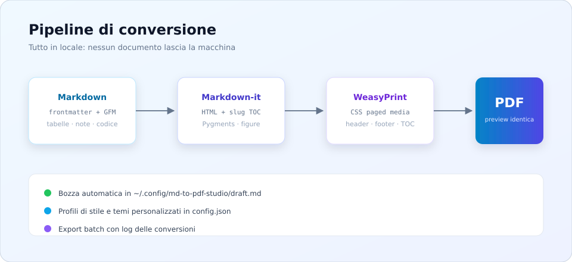

# Introduzione

**MD → PDF Studio** è un'applicazione locale che converte documenti Markdown in PDF
impaginati, senza inviare nulla a servizi esterni. Questa guida è anche un test di
resa: contiene tutti gli elementi supportati dal motore.

> La preview nell'interfaccia usa gli stessi byte del PDF esportato. Ciò che vedi
> è esattamente ciò che ottieni.

## Perché un'applicazione locale

- **Privacy**: i documenti restano sulla macchina.
- **Riproducibilità**: profili e temi sono salvati in JSON.
- **Controllo**: font, margini, header, footer, copertina e watermark.
- **Automazione**: export batch e log delle conversioni.

### Checklist di avvio

- [x] Installare le dipendenze di sistema
- [x] Creare il virtualenv e installare `requirements.txt`
- [x] Avviare con `./run.sh`
- [ ] Salvare il proprio profilo preferito

## Architettura

Il flusso è lineare: il Markdown viene analizzato, trasformato in HTML semantico e
impaginato tramite CSS *paged media*. La preview usa PDF.js per mostrare il PDF reale,
pagina per pagina.

| Componente | Tecnologia | Ruolo |
|:-----------|:-----------|:------|
| Editor | HTML + JavaScript vanilla | Scrittura e highlighting |
| Parser | markdown-it-py | Markdown → HTML |
| Evidenziazione | Pygments | Blocchi codice |
| Impaginazione | WeasyPrint | PDF con header/footer |
| Fallback | Chromium headless | Se WeasyPrint non è disponibile |
| Preview | PDF.js | Rendering fedele del PDF |

### Codice di esempio

~~~python linenums
from pathlib import Path

from app.converter import convert_document

def esporta(sorgente: Path, destinazione: Path) -> None:
    markdown = sorgente.read_text(encoding="utf-8")
    risultato = convert_document(markdown, settings={})
    destinazione.write_bytes(risultato.pdf)
    print(f"Creato {destinazione} ({risultato.page_count} pagine)")
~~~

Il blocco precedente mostra l'evidenziazione della sintassi e la numerazione delle
righe. I linguaggi non riconosciuti vengono comunque resi come testo monospaziato.

### Diagrammi Mermaid

I blocchi con linguaggio `mermaid` vengono renderizzati in locale con Chromium e
inseriti nel PDF come immagini ad alta risoluzione.

~~~mermaid
flowchart LR
  MD[Markdown] --> Parser[markdown-it]
  Parser --> HTML[HTML + CSS]
  Parser --> Mermaid[Mermaid]
  Mermaid --> PNG[PNG 2×]
  HTML --> PDF[WeasyPrint]
  PNG --> PDF
~~~

### Formule LaTeX

Le formule inline usano `$...$`, quelle in blocco `$$...$$`; sono supportati anche
`\(...\)` e `\[...\]`. La resa utilizza KaTeX e i font matematici inclusi.

L'identità più famosa è $E = mc^2$, mentre il teorema di Pitagora è
$a^2 + b^2 = c^2$. Un esempio in blocco:

$$
\int_0^\infty e^{-x^2}\,dx = \frac{\sqrt{\pi}}{2}
$$

$$
\sum_{i=1}^{n} i = \frac{n(n+1)}{2}, \qquad
\nabla \cdot \mathbf{E} = \frac{\rho}{\varepsilon_0}
$$

\newpage

# Formattazione e stile

## Testo e accenti

Il testo italiano con accenti — perché, è, à, ù, ò, ì — e caratteri speciali
(`&`, `<`, `>`, `"`) viene gestito correttamente. Anche le emoji sono supportate:
🚀 📄 ✅ 🎨.

Puoi usare **grassetto**, *corsivo*, ~~testo barrato~~, `codice inline` e
[link esterni](https://example.com). Le note a piè di pagina[^nota] sono collegate
al testo e numerate automaticamente.

[^nota]: Questa è una nota a piè di pagina. Nel PDF il riferimento è cliccabile.

## Tabelle lunghe

Le tabelle ripetono l'intestazione quando si spezzano su più pagine. Le righe non
vengono mai tagliate a metà.

| # | Attività | Responsabile | Stato | Note |
|--:|:---------|:-------------|:-----:|:-----|
| 1 | Analisi dello script legacy | Team | Completata | Pandoc + WeasyPrint |
| 2 | Struttura del progetto | Team | Completata | FastAPI + SPA |
| 3 | Motore Markdown | Team | Completata | Plugin GFM |
| 4 | Generazione PDF | Team | Completata | WeasyPrint |
| 5 | Preview PDF | Team | Completata | PDF.js |
| 6 | Profili e temi | Team | Completata | config.json |
| 7 | Export batch | Team | Completata | API REST |
| 8 | Test automatici | QA | Completata | pytest + Playwright |
| 9 | Documentazione | Team | Completata | README |
| 10 | Rilascio locale | Team | In corso | v1.0 |
| 11 | Verifica accessibilità | QA | Pianificata | Contrasto e tastiera |
| 12 | Raccolta feedback | Team | Pianificata | Uso quotidiano |

# Appendice

## Scorciatoie

| Comando | Azione |
|:--------|:-------|
| `Ctrl+S` | Salva il Markdown |
| `Ctrl+E` | Esporta il PDF |
| `Ctrl+P` | Aggiorna la preview |
| `Ctrl+O` | Apri un file |
| `Ctrl+,` | Apri le impostazioni |

## Variabili header/footer

Le variabili disponibili sono `{title}`, `{author}`, `{date}`, `{page}`, `{pages}`
e `{filename}`. Possono essere combinate liberamente, ad esempio:

~~~text
footerCenter = "{author} · {page}/{pages}"
~~~

## Limitazioni note

1. Le immagini relative richiedono che il documento sia aperto da percorso
   (così la cartella di base è nota) oppure un percorso assoluto/URL.
2. Il fallback Chromium non supporta i margin box CSS: header e footer possono
   differire dal motore WeasyPrint.
3. I font devono essere installati nel sistema; l'app elenca quelli disponibili
   tramite fontconfig.
