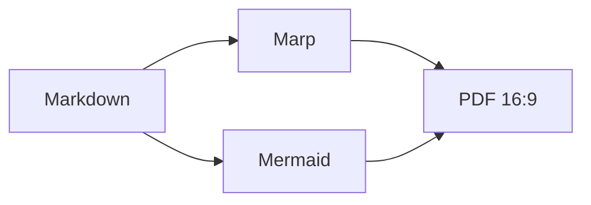

<!-- _class: lead -->
<!-- _paginate: false -->

# MD → PDF Studio

### Presentazioni Marp, in locale

**Mermaid · LaTeX · PDF 16:9**

---

## Diagrammi nelle slide

- slide separate da `---`
- diagrammi Mermaid renderizzati in locale
- paginazione automatica

---

## Formule e contenuti

La formula di Einstein è $E = mc^2$.

$$
\int_0^\infty e^{-x^2}\,dx = \frac{\sqrt{\pi}}{2}
$$

> Esporta in PDF: una slide per pagina.
